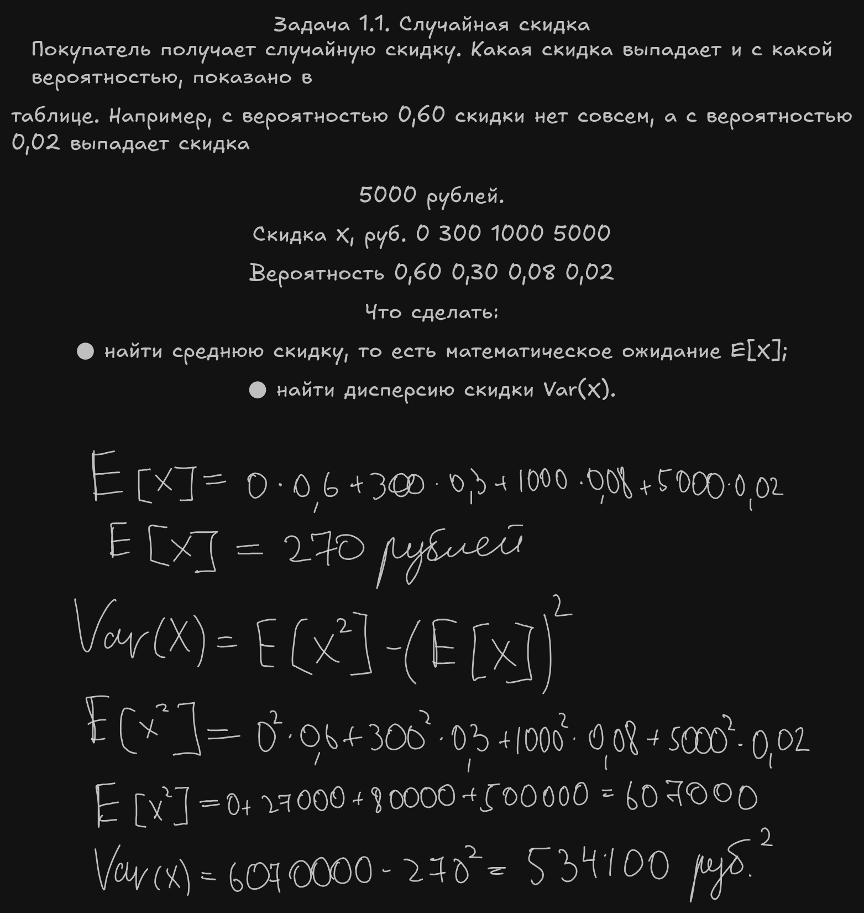
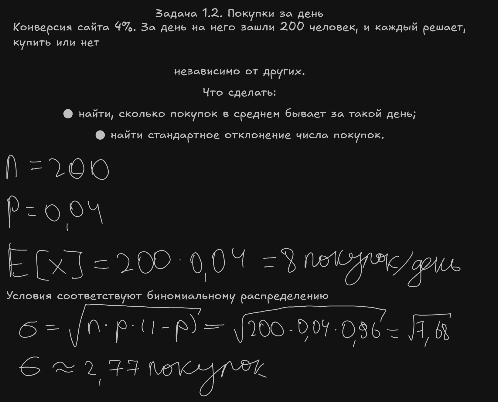
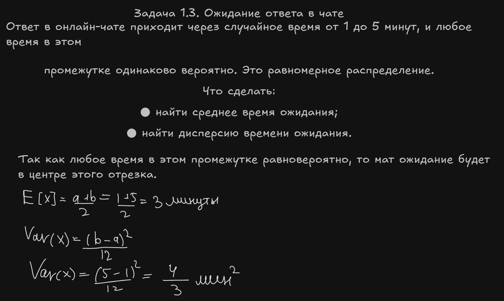

# 1. Задачи на бумаге

## Задача 1.1. Случайная скидка

## Задача 1.2. Покупки за день

## Задача 1.3. Ожидание ответа в чате

## Задача 1.4. Какое это распределение?

Что сделать: для каждой ситуации назвать подходящее распределение и в одном-двух
предложениях объяснить почему.
● а) сколько соискателей из 500, открывших вакансию, откликнутся;
● б) время работы сервера до сбоя, если сбои случаются случайно и не зависят от того, сколько
сервер уже проработал;
● в) рост взрослого человека в большой случайной группе людей;
● г) ежемесячный платёж по кредитной карте, если у большинства клиентов он небольшой, а у
немногих очень большой.

## Решение

a) Биномиальное распределение, потому что у каждого из соискателей только 2 исхода: откликнутся или нет с некоторой одинковой вероятностью. При чем соискатели независимы.

б) Экспоненциальное распределение, потому что, если сервер может сломаться в любой момент, при этом, вероятность этого не зависит от времени, которое он уже проработал, то время ожидания описывается экспонентой.

в) Нормальное распределение. Рост человека складывается из большого количества случайных факторов, и по центральной предельной теореме - это нормальное распределение.

г) Логнормальное распределение. Большинство клиентов описывают пик слева,а немногие образуют длинный хвост вправо. Еще сумма платежа не может быть отрицательной.
